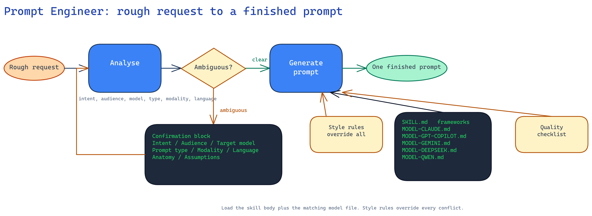

# Skills

A collection of agent skills. Each skill turns a rough request into a finished result. Maintained by Marcus Ford.

## Skills

### User-invoked

These skills run only when you type the name.

| Skill | Description |
| --- | --- |
| _None yet_ | |

### Model-invoked

These skills fire on their own when the task fits. Type the name to run one directly.

| Skill | Description |
| --- | --- |
| [prompt-engineer](productivity/prompt-engineer/) | Turns a rough request into one finished prompt for a target AI model. Also critiques, tests, and improves prompts. |

## Install

Setup runs in five places.

1. [OpenCode](#opencode), a native skill, no setup beyond the files.
2. [Microsoft 365 Copilot](#microsoft-365-copilot), regular Copilot, not Copilot Studio.
3. [ChatGPT](#chatgpt).
4. [Gemini](#gemini-gems).
5. [Claude](#claude).

### Files

- `productivity/prompt-engineer/SKILL.md`, the agent instructions, frameworks, and style rules.
- `productivity/prompt-engineer/MODEL-CLAUDE.md`, `productivity/prompt-engineer/MODEL-GPT-COPILOT.md`, `productivity/prompt-engineer/MODEL-GEMINI.md`, `productivity/prompt-engineer/MODEL-DEEPSEEK.md`, and `productivity/prompt-engineer/MODEL-QWEN.md`, the model knowledge files.
- `productivity/prompt-engineer/agents/openai.yaml`, the OpenAI and Codex interface manifest.

Install needs the `prompt-engineer` folder alone. Keep the files together inside the folder. The `docs` folder holds the flow diagram for reference and forms no part of the install.

### Agent instructions

The agent instructions live in `productivity/prompt-engineer/SKILL.md`. Copy the body of that file, from the `# Prompt Engineer` heading down, into the platform instructions field. The front matter at the top is for OpenCode only and is not part of the pasted text.

When the platform supports knowledge files, upload the five model knowledge files from the skill folder. When the platform does not, paste the SKILL.md body and the matching model file into the knowledge or context area, or prepend both to a request.

### OpenCode

OpenCode loads skills from disk. No account or app is needed.

1. Copy the `prompt-engineer` folder into a skills directory.
   - Project scope: `<your-project>/.opencode/skills/prompt-engineer/`
   - Global scope: `~/.config/opencode/skills/prompt-engineer/`
2. Keep the folder layout intact, so `SKILL.md` and the knowledge files stay together.
3. Start a new OpenCode session so the session discovers the skill.
4. Ask in plain language, for example: write me a prompt for a non-technical executive summary, targeting ChatGPT.

Verify: the session lists `prompt-engineer` among available skills.

### Microsoft 365 Copilot

Regular Microsoft 365 Copilot Chat, not Copilot Studio.

1. Sign in at <https://m365.cloud.microsoft/chat>, or open Copilot in Teams.
2. Choose Create an agent, or open the Agents area and pick New agent.
3. Name the agent Prompt Engineer and give the agent a short description.
4. Paste the SKILL.md body into the Instructions box.
5. Under Knowledge, add the five model knowledge files. Upload the files from OneDrive or SharePoint, since Copilot grounds agents on Microsoft 365 content.
6. Save, then open the agent from Copilot Chat and describe the prompt you want.

If the tenant does not show the agent builder, use the no-setup path. Start a Copilot chat, paste the SKILL.md body, then add the request on the next line. Save the instructions for reuse.

### ChatGPT

Two options. Custom GPTs support knowledge files. Custom instructions apply to every chat.

#### Custom GPT, knowledge files supported

1. Open ChatGPT and go to Explore GPTs, then Create.
2. Switch to the Configure tab.
3. Set the name to Prompt Engineer and add a short description.
4. Paste the SKILL.md body into the Instructions box.
5. Under Knowledge, upload the five model knowledge files.
6. Save, then set the access level for the GPT. Open the GPT and describe the prompt you want.

#### Custom instructions, no files

1. Open Settings, then Personalization, then Custom instructions.
2. Paste the SKILL.md body into the field about how ChatGPT should respond.
3. Save. Start a new chat and describe the prompt you want.

Note: custom instructions have a length limit. If the body does not fit, paste the framework section and trim the model list.

### Gemini (Gems)

Gems are the saved, reusable assistants in Gemini.

1. Open <https://gemini.google.com> and choose Gems in the sidebar.
2. Choose New Gem.
3. Name the Gem Prompt Engineer and add a short description.
4. Paste the SKILL.md body into the instructions field.
5. Attach the five model knowledge files if the plan allows uploads.
6. Save, then open the Gem and describe the prompt you want.

Note: file attachments in Gems need a paid Google plan. Without uploads, paste the SKILL.md body into the first message of a chat and keep the Gem open.

### Claude

Claude Projects hold instructions plus a project knowledge base.

1. Open <https://claude.ai> and go to Projects.
2. Choose New Project and name the project Prompt Engineer.
3. Open the project instructions and paste the SKILL.md body.
4. Add the five model knowledge files to the project knowledge.
5. Start a chat inside the project and describe the prompt you want.

Alternative without a Project: open Settings, then Profile, and paste the SKILL.md body into the custom instructions field. This applies to every chat and carries no knowledge files.

### Check the setup

Send this request on any platform:

> Write me a prompt for turning a meeting transcript into five action items with owners.

Check the reply against three things:

- The reply returns one finished prompt, with no preamble.
- The reply follows the style rules in SKILL.md: no em dashes, no banned words.
- The reply names the target model, or defaults to Claude when you do not name one.

### Tips

- Name the target model every time. Each model family has its own prompt mechanics.
- Say what the audience cares about. Non-technical executives beats general audience.
- Ask for a system prompt explicitly when you configure a bot.
- For images and documents, say what is attached and what to extract.
- Refine in place. Follow-ups adjust the same prompt rather than starting over.

## prompt-engineer



Turns a rough request into one finished, ready-to-use prompt for a chosen AI model. Ask for a prompt, and get a single usable result rather than a draft. Give an existing prompt, and the skill critiques, tests, or improves the prompt against best practice.

Runs as an OpenCode skill, and as an agent or Gem on Microsoft 365 Copilot, ChatGPT, Gemini, and Claude.

### Supported models

| Target | Knowledge file |
| --- | --- |
| Claude, the default | `productivity/prompt-engineer/MODEL-CLAUDE.md` |
| ChatGPT, Microsoft Copilot | `productivity/prompt-engineer/MODEL-GPT-COPILOT.md` |
| Gemini | `productivity/prompt-engineer/MODEL-GEMINI.md` |
| DeepSeek | `productivity/prompt-engineer/MODEL-DEEPSEEK.md` |
| Qwen | `productivity/prompt-engineer/MODEL-QWEN.md` |

`productivity/prompt-engineer/SKILL.md` always loads. The file carries the frameworks and the style rules. The model files add the mechanics each family needs.

## Repository layout

```text
productivity/
  prompt-engineer/
    SKILL.md                        agent instructions, frameworks, style rules
    MODEL-CLAUDE.md                 Claude mechanics
    MODEL-GPT-COPILOT.md            ChatGPT and Copilot mechanics
    MODEL-GEMINI.md                 Gemini mechanics
    MODEL-DEEPSEEK.md               DeepSeek mechanics
    MODEL-QWEN.md                   Qwen mechanics
    agents/openai.yaml              OpenAI and Codex interface manifest

docs/
  prompt-engineer-flow.excalidraw   editable diagram source
  prompt-engineer-flow.png          rendered diagram
```

## License

MIT. See [LICENSE](LICENSE).
